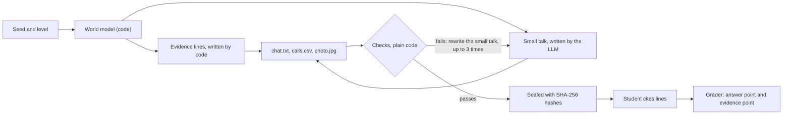

# Suraag (सुराग)

[](https://github.com/Avan14/Suraag/actions/workflows/tests.yml)
[](LICENSE)

Fictional Indian forensic practice cases, **proved solvable by plain code**, with a grader that scores a
student on the answer **and on the exact evidence line they cite for it**.

**Live demo: https://suraag-1.streamlit.app** (no login; it sleeps when idle, so the first load can take
about 30 seconds). Open **Student**, pick a level and a case, click the lines that prove each answer, then
press **Submit answers**.

> **All data is synthetic and for teaching only.** Names, phone numbers (`+91-5xxxx-xxxxx`, a range that
> is never a valid Indian mobile number, though it can match some fixed lines and short codes), UPI handles
> and accounts are invented. Nothing here is
> court-validated or legal advice. SHA-256 hashes show a file is unchanged since generation; they do **not**
> prove it is authentic.

## Who it is for, and the problem

Suraag is for lecturers who teach digital forensics or cyber law in India, and for their students. Writing a
practice case by hand is slow, and a case an LLM writes on its own can contradict itself or have an answer the
files do not support. Grading usually checks only the final answer, not whether the student can point to the
line that proves it. Suraag generates cases whose answers are checked by code before anyone sees them, and
grades the evidence a student cites as well as the answer.



## What it does

- **Generates** a UPI-fraud case from a seed: a WhatsApp-style chat export (English or Hinglish), a call-log
  CSV, and a photo with EXIF metadata. Code builds the world model and writes the key evidence lines
  *verbatim*; an LLM (Gemini) writes only the filler around them.
- **Verifies** every case with deterministic code before it ships: anchors, traceability, contradictions
  (time order, one person per alias, cause before effect), solvability (a rule-based solver reproduces the
  answer key from the files and the student brief alone), a plausible distractor, and sealed SHA-256 hashes.
  A failing artifact is regenerated with the error message as input (up to 3 tries); a case that cannot be
  repaired is discarded and logged.
- **Grades** students per question on two points: the answer, and the evidence. A cited line is *valid* if it
  contains every string the claim needs (it need not be the designated anchor), *partial* if it has some,
  *wrong* if none. Explanations come from the verifier's own data, e.g.
  `chat.txt:3 contains neither "9:14 pm" nor "Raju bhai". A supporting line is chat.txt:12.` The same input
  always gives the same score. A student's free-text reasoning is never scored: it is flagged for the
  instructor. The grader has a hook for an LLM "overclaim" check, but no classifier is wired in yet, so every
  reason is flagged "could not verify".
- **Teaches in two languages:** the interface and every grader/verifier message in English and हिन्दी;
  case content in English and Hinglish. Hints are tiered (file → rows → exact lines), built in code from the
  case model, never by the LLM, and never contain the culprit or the evidence text.
- **Levels up:** four practice levels. Levels 2 to 4 add traps that make a named shortcut give a plausible
  wrong answer, and a depth check proves each trap really misleads. After submitting, a student can open a
  worked solution for every question (see [Practice levels](#practice-levels)).

## Try it

```bash
python -m venv .venv && .venv/Scripts/activate        # or source .venv/bin/activate
pip install -r requirements.txt
streamlit run app.py
```

Fourteen pre-generated cases in four levels are in `cases/`, so the app works with no API key. To generate with a live LLM,
put `GEMINI_API_KEY`, `SURAAG_MODEL_FILLER` and `SURAAG_MODEL_SOLVER` in `.env` (see `.env.example`); on
Streamlit Community Cloud put them in the app's secrets. With no key, or when the LLM is unavailable, the
pipeline falls back to deterministic stub filler and the manifest says `"model": "stub"`.

Every LLM reply is cached in `.llm_cache/`, and the cache is committed. The same seed and prompt therefore replay
the same text, on the live site too, and the demo works offline. A new seed, or a changed prompt, calls the LLM.

```bash
python -m suraag.pipeline --seed 7 --lang hinglish --out out/demo --defect timestamp_clash   # watch it catch and repair
python -m suraag.pipeline --seed 41 --lang en --level 4 --out out/expert                     # a level 4 case
python -m pytest                                                                             # 225 offline tests
```

## Practice levels

The five original cases are level 1: one chat line names the order, an exact contact-name match gives the
number, and the photo GPS gives the place. Searching for "delete" solves them. Levels 2 to 4 add **traps**.
Each trap makes one specific shortcut give a plausible wrong answer, and the files carry the evidence that
avoids it. From level 2 the decoy is also the boss's **namesake** (two suspects called, say, Debashish), so a
chat name never picks a suspect on its own: only a phone number does.

| Level | Questions | Traps | What it practises |
|---|---|---|---|
| 1 Rookie | who, when, where | none | read a chat line, match a saved contact to its number, place a GPS point |
| 2 Investigator | who, when, where | unsaved caller, alibi | link a message to a phone call by time; trust the GPS over a claim in the chat |
| 3 Inspector | adds the photo time in IST | code word, decoy, camera clock | decode a code set up earlier; find the order that was carried out; convert a camera clock |
| 4 Expert | four | all five, in a longer chat | everything at once |

| Trap | What the files show | The shortcut, and where it leads |
|---|---|---|
| Unsaved caller | The boss's number is not saved; the order says "as I said on the phone just now"; a second unsaved suspect also calls | Match the chat name to the call log by first name: the namesake |
| Alibi | The mule writes "Still stuck near Hadapsar" minutes before the photo | Believe the chat: the wrong place. The GPS, unedited, says otherwise |
| Code word | Early on, someone sets a rule: when anyone writes "the blue kite is up", delete the entry. The boss later writes only the phrase | Search for "delete": the rule line, so the wrong time and person |
| Decoy | The mule replies "Done"; afterwards the namesake asks to remove a different entry | Take the latest delete request: the namesake |
| Camera clock | EXIF `DateTimeOriginal` is on UTC (`OffsetTimeOriginal` +00:00) | Read it as IST: 5 h 30 min off |

**How it is verified.** The rule-based solver gained three reading rules (code definitions, the confirmed
order, a call referenced by the order) and the photo-clock conversion; each fires only where level 1 would be
unsolvable, so level 1 answers do not change. A seventh check, **depth**, runs a shortcut reader for each trap
and fails the case unless that reader lands on a real wrong answer (not the key, not "unsolvable"). The
grader now needs **every step** of a multi-step answer cited: at level 4, "who" rests on the code rule, the
order, the call and the mule's reply.

**How it explains itself.** After submitting, each question has a "How to solve it" panel: the reasoning steps
with the exact line for each, the answer, and the traps with the wrong answer each one leads to. It is built
in code from the case and the files, never by the LLM, and a trap is shown only if the shortcut really fails on
those files. `solution.md` in each case folder holds the same for the instructor (it contains the answers).

## Results so far (all on synthetic cases; sample sizes beside every figure)

| Experiment | Result | n | Notes |
|---|---|---|---|
| Defect detection | 20 of 20 planted defects caught by the check meant for them | 20 (5 per type) | The defects are planted by our own code, so this shows the checks work, not how often real generators err. 0 of 5 clean cases flagged. |
| Raw LLM vs hybrid + verifier | **Hybrid + verifier: 20 of 20 cases shipped** (English 7/10 on the first try, Hinglish 10/10; the 3 English first-try failures were filler-content rule violations, repaired). **Raw (LLM writes the whole chat): 2 of 19 passed on the first try, 8 of 19 after up to 3 repairs.** First try,
17 of 20 (95% Wilson interval 0.64 to 0.95) against 2 of 19 (0.03 to 0.31), Fisher exact p = 3.4e-6; after
repair, 20 of 20 (0.84 to 1.00) against 8 of 19 (0.23 to 0.64), p = 4.5e-5. Most common raw failure: chat and call-log times disagreeing (17 of 19 cases) | English 10+10, Hinglish 10+9 (1 raw case excluded: API quota) | One case family, synthetic data, one model (`gemini-3.5-flash`). Raw mode is judged on chat checks only, so it should look better than a plain chat. Excluded cases are reported, never counted as failures. The `seconds_per_case` field is not a speed result: three runs replayed cached LLM replies (about 0.02 s a case), and only Hinglish raw made live calls (about 75 s). `eval/results.json`. |
| Plain-chat baseline | 8 of 10 flagged by a model first pass; **3 clear-cut** (wrong cited lines, a range instead of a time, a self-contradicting key); human confirmation pending | 10 | One chat app, one prompt, `eval/plain_baseline/`. The other 5 flags rest on a strict reading. Not yet a person's check. |
| Grader agreement with manual grading | **not run yet** | 20 drafted | Needs human labels: `eval/grader_worksheet.md` |
| Blind solve by a second model | `gemini-3.6-flash` agreed with the key on **30 of 30 questions** (who, when, where; 10 of 10 cases each) on stub filler, and again **30 of 30 on real LLM filler** | 10 + 10 | Shows the cases are solvable from the files alone; it does not show they are hard. Unscored, one model. |
| Practice levels: generation | **9 of 9 level 2 to 4 cases sealed** with real LLM filler, 8 on the first try and 1 after one repair (a filler line used an instruction verb). Every trap passed the depth check | 3 per level | One model (`gemini-3.5-flash`), English and Hinglish mixed. `cases/L*`. |
| Practice levels: blind solve | `gemini-3.6-flash` agreed with the key on level 1 **15 of 15**, level 2 **9 of 9**, level 3 **8 of 12**, level 4 **12 of 12**. All 4 level 3 misses came from the code-word trap: in both Hinglish level 3 cases it named the author of the code rule (who) and gave the rule's time (when). `results.json` scores each trap on one question, so it records these as 2 trap answers | 5 + 3 + 3 + 3 cases | Unscored, one model, 3 cases per level. Level 4 was not harder than level 3 for this model: its order adds "as I said on the phone", which may make the order line easier to spot. `eval/results.json`. |

## Limits (please read)

- Synthetic data, small samples, **one case family** (a UPI-fraud ring), not court-validated.
- In hybrid mode the anchored lines are written by code, so the anchor check passes *by construction*; the
  planted-defect experiment shows the checks fire, not that real LLM filler needs them. The raw-vs-hybrid
  experiment is the one that measures that.
- The rule-based solver proves a case is consistent with its templates. Whether a *person* can solve it is
  what a human playtest is for; the model blind solve is done (above), the human one is not.
- The Hindi strings are a first draft and **need a native reader's review**.
- The traps are templates: every level 3 case uses the same kinds of trap with different people, times and
  places. The depth check shows a named shortcut fails, not that a person would take it; that needs a playtest.
- The hash is an integrity record, not proof of authenticity.
- The exported-file artifacts (`chat.txt`, `calls.csv`, `photo.jpg`) are less realistic than full device
  images from emulation-based generators.

## Prior art we build on

Synthetic forensic scenarios with ground truth already exist:
[**EvidenceForge**](https://github.com/Cisco-Talos/EvidenceForge) (Cisco Talos), the **DFRWS EU 2026** work on
LLM-driven scenario generation (Plankl et al.), **hystck / ForTrace**, and
[**EviPlant**](https://arxiv.org/abs/1704.08990), mostly for tool testing and DFIR practice. Like EvidenceForge's
ground-truth file and generation manifest, every Suraag case ships a machine-readable key (`case.json`) and a
manifest with the seed, model, prompt hashes, a SHA-256 per file and a seal time. Solver-checked generation is established for LLM
logic puzzles. We claim only the *combination*, aimed at teaching: a verifier that checks a case's answer key
is derivable from its evidence, grading by the evidence a student cites, and Hindi/Hinglish Indian-context
artifacts. We do not claim to be first.

## Responsible use and AI

- **What the LLM does.** It writes only the small talk between the evidence lines. Code writes every evidence
  line, hint, worked solution and score, and checks the small talk for digits, amounts, dates, web addresses,
  real brands and instruction verbs. Models: `gemini-3.5-flash` writes the small talk; `gemini-3.6-flash` is
  used only for the blind-solve experiment. The raw-mode baseline above shows what happens when the LLM writes
  the evidence too.
- **What is sent to Gemini.** Only generation prompts built from synthetic data: the chat members' made-up
  names, the time gaps to fill, and, on a repair, the checker's error messages. The blind-solve experiment sends
  a synthetic case's brief and files. No student answer or personal data is ever sent.
- **What is stored.** A student's answers live only in their browser session and are gone when it ends. The
  app writes to disk only when a live generation fails: one line with the case id, mode, language and failing
  checks. Live generation is capped at 20 cases a day per running copy of the app (the count resets on a restart).
- **Misuse.** Cases show the evidence a fraud leaves on a phone, not how to run one: the orders are short
  template lines ("delete the transfer record"), with no persuasion scripts.
- **Answer keys are public.** Every case folder holds its key (`case.json`) and worked solution
  (`solution.md`), so the public demo is for practice, not assessment. Set `SURAAG_LECTURER_CODE` in the app's
  secrets to put the key download behind a code, and generate fresh seeds for real assessment.
- **Names and fairness.** Names come from four regional pools (north, west, south, east), 7 first names and
  6 surnames each. They do not yet include Muslim, Christian, Sikh or North-East names; adding names changes
  every seed's draws, and so every shipped case, so it is planned with the next regeneration. Guilt is
  assigned at random: chi-square tests over 1,000 seeds (level 1) and 400 seeds per level (levels 1 to 4) find
  no link between a suspect's region or gender and guilt.
- **People decide.** A human instructor has the last word. Nothing here is legal advice, and every page
  points real victims to the 1930 helpline and cybercrime.gov.in.

## Layout

`suraag/` the engine (`model`, `skeleton`, `levels`, `render`, `verify`, `repair`, `solver`, `grade`,
`explain`, `hints`, `i18n`, `pipeline`) · `suraag/components/` the evidence board and read-aloud · `app.py` the Streamlit app ·
`docs/RULES.md` the rules register (each rule traced to a source, a test and a status; 15 Implemented, 16 Partial) · `docs/research/` the research it rests on · `eval/` the experiments · `cases/` pre-generated cases (each folder includes `case.json`, the instructor's
answer key, and `solution.md`, the worked solution; `L2-`, `L3-` and `L4-` folders are the practice levels) · `tests/`.
